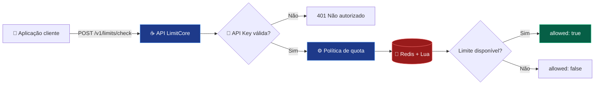

<div align="center">

# ⚡ LimitCore

### Controle de requisições distribuído, com decisões atômicas e arquitetura orientada à confiabilidade.

**Java 25 · Spring Boot · Redis · Lua · Docker**

[](https://github.com/emanuelleda/limitcore/actions/workflows/ci.yml)
[](https://github.com/emanuelleda/limitcore/actions/workflows/security.yml)


**[Começar](#-início-rápido) · [Arquitetura](#-arquitetura) · [Algoritmos](#-algoritmos) · [Documentação](#-documentação)**

</div>

---

## ✨ Visão geral

O **LimitCore** é uma API REST open source para **rate limiting distribuído**. Ela permite que sistemas consultem se uma requisição pode ser aceita conforme uma quota definida no servidor.

O estado das decisões é compartilhado no **Redis**, enquanto scripts **Lua** garantem operações atômicas no primário. A API pode ser executada em múltiplas instâncias conectadas ao mesmo Redis.

| 🔐 Segurança inicial | ⚙️ Consistência | 🧪 Qualidade | 📈 Observabilidade |
| :---: | :---: | :---: | :---: |
| API Key e quotas no servidor | Scripts Lua atômicos | JUnit, Testcontainers e CI | OpenAPI, Prometheus e Grafana |
| Identificadores com hash SHA-256 | Estado compartilhado no Redis | CodeQL e JaCoCo | Benchmark inicial com k6 |

> [!IMPORTANT]
> **Projeto em evolução.** Há testes automatizados e verificações de segurança, mas ainda são necessárias validações de carga, *failover*, isolamento multitenant e operação antes de declarar prontidão para produção.

## 🏗️ Arquitetura



<sub>As respostas de decisão utilizam HTTP 200 com o campo `allowed`. O cliente é responsável por aplicar o bloqueio; o LimitCore não funciona como proxy.</sub>

## 🧠 Algoritmos

| Algoritmo | Identificador | Como funciona | Característica |
| --- | --- | --- | --- |
| **Fixed Window** | `fixed-window` | Contador com expiração | Simples e econômico |
| **Token Bucket** | `token-bucket` | Tokens repostos progressivamente | Permite rajadas controladas |
| **Sliding Window** | `sliding-window` | Eventos em janela móvel | Controle mais preciso |

Todos usam scripts Lua para manter a operação atômica em um primário Redis. [Entenda as diferenças →](docs/algorithms.md)

## 🚀 Início rápido

**Pré-requisitos:** Java 25, Maven 3.9+ e Docker Compose.

**1. Clone o projeto**

```bash
git clone https://github.com/emanuelleda/limitcore.git
cd limitcore
```

**2. Inicie o Redis**

```bash
docker compose up -d
```

**3. Configure o ambiente**

```bash
export LIMITCORE_API_KEY="$(openssl rand -hex 32)"
export LIMITCORE_ALGORITHM=token-bucket
export LIMITCORE_CAPACITY=100
export LIMITCORE_WINDOW_SECONDS=60
```

**4. Execute a API**

```bash
mvn spring-boot:run
```

## 🔌 Experimente a API

<details open>
<summary><strong>POST /v1/limits/check — consultar uma decisão</strong></summary>

```bash
curl -X POST http://localhost:8080/v1/limits/check \
  -H "Content-Type: application/json" \
  -H "X-API-Key: $LIMITCORE_API_KEY" \
  -d '{"key":"cliente-123"}'
```

**Exemplo de resposta autorizada**

```json
{
  "allowed": true,
  "algorithm": "token-bucket"
}
```

**Exemplo de resposta com limite atingido**

```json
{
  "allowed": false,
  "algorithm": "token-bucket"
}
```

Uma credencial inválida ou ausente retorna **HTTP 401**. Uma decisão negativa retorna **HTTP 200**, portanto o consumidor deve verificar o campo `allowed`.

</details>

## 🧰 Tecnologias e ferramentas

| Camada | Tecnologias |
| --- | --- |
| **Backend** | Java 25, Spring Boot 3.5 |
| **Estado distribuído** | Redis, scripts Lua |
| **Testes** | JUnit, Mockito, Testcontainers |
| **Build e infraestrutura** | Maven, Docker, Docker Compose |
| **CI e segurança** | GitHub Actions, CodeQL, Dependabot |
| **Qualidade** | JaCoCo, configuração SonarQube |
| **Observabilidade** | OpenAPI, Prometheus, Grafana, k6 |

## 🧪 Testes e integração contínua

```bash
mvn verify
```

O pipeline inclui **testes unitários**, **testes de integração com Redis** e um **cenário de concorrência** para janela fixa. Os workflows de CI e segurança ficam disponíveis na aba [Actions](https://github.com/emanuelleda/limitcore/actions).

A configuração do SonarQube está preparada, mas uma análise conectada e seu *quality gate* ainda dependem de configuração externa.

## ⚙️ Configuração

| Variável | Padrão | Finalidade |
| --- | --- | --- |
| `LIMITCORE_API_KEY` | Vazio | Credencial de acesso; vazia, rejeita todas as chamadas |
| `LIMITCORE_ALGORITHM` | `fixed-window` | Algoritmo selecionado |
| `LIMITCORE_CAPACITY` | `100` | Capacidade máxima |
| `LIMITCORE_WINDOW_SECONDS` | `60` | Período de referência |
| `REDIS_HOST` | `localhost` | Servidor Redis |
| `REDIS_PORT` | `6379` | Porta Redis |

> [!NOTE]
> O endpoint de métricas Prometheus **não é exposto por padrão**. Habilite-o apenas em uma rede protegida, configurando `MANAGEMENT_ENDPOINTS_WEB_EXPOSURE_INCLUDE=health,info,prometheus` e controlando o acesso administrativo.

## 📚 Documentação

| Documento | Conteúdo |
| --- | --- |
| [🏗️ Arquitetura](docs/architecture.md) | Componentes, fluxo e garantias |
| [🧠 Algoritmos](docs/algorithms.md) | Fixed Window, Token Bucket e Sliding Window |
| [📘 Contrato OpenAPI](docs/openapi.yaml) | Endpoint, autenticação e respostas |
| [📊 Operação](docs/operations.md) | Monitoramento, incidentes e recuperação |
| [🧪 Qualidade](docs/quality.md) | Testes, segurança e critérios de publicação |
| [📝 ADR Redis Lua](docs/adr/0001-redis-lua.md) | Decisões arquiteturais |
| [🔒 Segurança](SECURITY.md) | Riscos, recomendações e divulgação responsável |
| [🤝 Contribuição](CONTRIBUTING.md) | Como colaborar com o projeto |

## 🗺️ Evolução do projeto

- [x] Três algoritmos de rate limiting distribuído
- [x] Quotas definidas pelo servidor e autenticação inicial por API Key
- [x] Testes unitários, integração e concorrência
- [x] CI, CodeQL, Dependabot e JaCoCo
- [x] Contrato OpenAPI e ferramentas iniciais de observabilidade
- [ ] Autenticação multitenant e políticas por cliente
- [ ] Proteção de cardinalidade e consumo de memória
- [ ] Tracing distribuído e testes de failover
- [ ] SonarQube conectado e benchmarks validados
- [ ] Auditoria e revisão operacional para produção

---

<div align="center">

### 🤝 Contribuições são bem-vindas

Encontrou um problema ou tem uma ideia? Abra uma [issue](https://github.com/emanuelleda/limitcore/issues) ou envie um pull request.

Desenvolvido por **[Emanuel Lêda](https://github.com/emanuelleda)**

Distribuído sob a **[Licença MIT](LICENSE)**.

</div>
