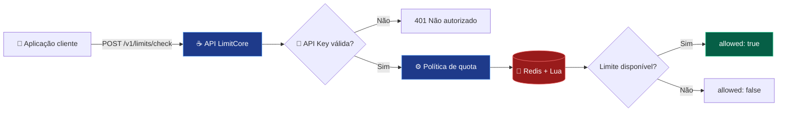

<div align="center">

# ⚡ LimitCore

### Controle de requisições distribuído, com decisões atômicas e arquitetura orientada à confiabilidade.

**Java 25 · Spring Boot · Redis · Lua · Docker**

[](https://github.com/emanuelleda/limitcore/actions/workflows/ci.yml)
[](https://github.com/emanuelleda/limitcore/actions/workflows/security.yml)


**[Começar](#-início-rápido) · [Arquitetura](#-arquitetura) · [Algoritmos](#-algoritmos) · [Documentação](#-documentação)**

</div>

---

## ✨ Visão geral

O **LimitCore** é uma API REST open source para **rate limiting distribuído**. Ela permite que sistemas consultem se uma requisição pode ser aceita conforme uma quota definida no servidor.

O estado das decisões é compartilhado no **Redis**, enquanto scripts **Lua** garantem operações atômicas no primário. A API pode ser executada em múltiplas instâncias conectadas ao mesmo Redis. A configuração opcional `LIMITCORE_TENANTS` permite autenticação por tenant e isolamento dos contadores; capacidades distintas podem ser configuradas por tenant; o período e o algoritmo ainda são globais.

| 🔐 Segurança inicial | ⚙️ Consistência | 🧪 Qualidade | 📈 Observabilidade |
| :---: | :---: | :---: | :---: |
| API Key e quotas no servidor | Scripts Lua atômicos | JUnit, Testcontainers e CI | OpenAPI, Prometheus e Grafana |
| Identificadores com hash SHA-256 | Estado compartilhado no Redis | CodeQL e JaCoCo | Benchmark inicial com k6 |

> [!IMPORTANT]
> **Projeto em evolução.** O código possui testes automatizados, verificação de imagem e simulação de failover Redis Sentinel; para produção ainda são obrigatórias validações de carga e segurança na infraestrutura real, conexão do SonarQube, provisão de segredos e revisão operacional. [Checklist de produção](docs/production-readiness.md).

## 🏗️ Arquitetura



<sub>As respostas de decisão utilizam HTTP 200 com o campo `allowed`. O cliente é responsável por aplicar o bloqueio; o LimitCore não funciona como proxy.</sub>

## 🧠 Algoritmos

| Algoritmo | Identificador | Como funciona | Característica |
| --- | --- | --- | --- |
| **Fixed Window** | `fixed-window` | Contador com expiração | Simples e econômico |
| **Token Bucket** | `token-bucket` | Tokens repostos progressivamente | Permite rajadas controladas |
| **Sliding Window** | `sliding-window` | Eventos em janela móvel | Controle mais preciso |

Todos usam scripts Lua para manter a operação atômica em um primário Redis. A janela deslizante aceita capacidade máxima de 10.000 eventos por chave; o registro atômico de chaves ativas impõe um limite adicional por tenant. [Entenda as diferenças →](docs/algorithms.md)

## 🛡️ Proteções do Redis

- **Limite de identificadores ativos:** por padrão, até `1.000` chaves lógicas ativas por tenant (`LIMITCORE_MAX_ACTIVE_KEYS`). A admissão e a operação da quota ocorrem no mesmo script Lua, sem corrida entre instâncias.
- **Expiração automática:** registros deixam de ocupar o limite depois da janela configurada. Quando o limite de identificadores é atingido, a API retorna `allowed: false` (não é uma falha HTTP).
- **Compatibilidade de cluster:** o estado de cada tenant usa uma *hash tag* comum para scripts multichave. O custo é concentrar a carga daquele tenant em um único slot.
- **Rotação gradual:** `LIMITCORE_TENANTS="alpha=segredoAntigo|segredoNovo"` aceita temporariamente duas credenciais. Retire a antiga e reinicie as instâncias após a migração. As credenciais precisam ter pelo menos 16 caracteres e não podem ser reutilizadas entre tenants.

> [!WARNING]
> **Migração do formato Redis:** esta implementação altera o padrão das chaves. Ao migrar da versão anterior, quotas em andamento são reiniciadas; programe a implantação para evitar decisões inesperadas durante a troca.

## 🚀 Início rápido

**Pré-requisitos:** Java 25, Maven 3.9+ e Docker Compose.

**1. Clone o projeto**

```bash
git clone https://github.com/emanuelleda/limitcore.git
cd limitcore
```

**2. Inicie o Redis**

```bash
docker compose up -d
```

**3. Configure o ambiente**

```bash
export LIMITCORE_API_KEY="$(openssl rand -hex 32)"
export LIMITCORE_ALGORITHM=token-bucket
export LIMITCORE_CAPACITY=100
export LIMITCORE_WINDOW_SECONDS=60
```

**4. Execute a API**

```bash
mvn spring-boot:run
```

## 🔌 Experimente a API

<details open>
<summary><strong>POST /v1/limits/check — consultar uma decisão</strong></summary>

```bash
curl -X POST http://localhost:8080/v1/limits/check \
  -H "Content-Type: application/json" \
  -H "X-API-Key: $LIMITCORE_API_KEY" \
  -d '{"key":"cliente-123"}'
```

**Exemplo de resposta autorizada**

```json
{
  "allowed": true,
  "algorithm": "token-bucket"
}
```

**Exemplo de resposta com limite atingido**

```json
{
  "allowed": false,
  "algorithm": "token-bucket"
}
```

Uma credencial inválida ou ausente retorna **HTTP 401**. Uma decisão negativa retorna **HTTP 200**, portanto o consumidor deve verificar o campo `allowed`.

</details>

## 🧰 Tecnologias e ferramentas

| Camada | Tecnologias |
| --- | --- |
| **Backend** | Java 25, Spring Boot 4.1.2 |
| **Estado distribuído** | Redis, scripts Lua |
| **Testes** | JUnit, Mockito, Testcontainers |
| **Build e infraestrutura** | Maven, Docker, Docker Compose |
| **CI e segurança** | GitHub Actions, CodeQL, Dependabot |
| **Qualidade** | JaCoCo com cobertura mínima, Trivy, configuração SonarQube |
| **Observabilidade** | OpenAPI, Prometheus, Grafana, Micrometer/OTLP, k6, Sentinel |

## 🧪 Testes e integração contínua

```bash
mvn verify
```

O pipeline inclui **testes unitários**, **testes de integração com Redis** e um **cenário de concorrência** para janela fixa. Os workflows de CI e segurança ficam disponíveis na aba [Actions](https://github.com/emanuelleda/limitcore/actions).

A configuração do SonarQube está preparada, mas uma análise conectada e seu *quality gate* ainda dependem de configuração externa.

## ⚙️ Configuração

| Variável | Padrão | Finalidade |
| --- | --- | --- |
| `LIMITCORE_API_KEY` | Vazio | Credencial legada compartilhada (tenant `default`) |
| `LIMITCORE_TENANTS` | Vazio | Credenciais opcionais por tenant no formato `tenant=segredo,tenant2=segredo2` |
| `LIMITCORE_TENANT_CAPACITIES` | Vazio | Capacidades opcionais por tenant: `tenant=20,tenant2=100` (mesmo período global) |
| `LIMITCORE_MAX_ACTIVE_KEYS` | `1000` | Máximo de identificadores ativos por tenant (1–100.000) |
| `REDIS_CONNECT_TIMEOUT` | `2s` | Tempo limite de conexão com Redis |
| `REDIS_COMMAND_TIMEOUT` | `2s` | Tempo limite das operações Redis |
| `LIMITCORE_OTLP_ENDPOINT` | `http://localhost:4318/v1/traces` | Coletor de traces OTLP |
| `LIMITCORE_TRACING_SAMPLE_RATE` | `0.1` | Probabilidade de amostragem de traces |
| `LIMITCORE_ALGORITHM` | `fixed-window` | Algoritmo selecionado |
| `LIMITCORE_CAPACITY` | `100` | Capacidade máxima |
| `LIMITCORE_WINDOW_SECONDS` | `60` | Período de referência |
| `REDIS_HOST` | `localhost` | Servidor Redis |
| `REDIS_PORT` | `6379` | Porta Redis |

> [!NOTE]
> O endpoint de métricas Prometheus **não é exposto por padrão**. Habilite-o apenas em uma rede protegida, configurando `MANAGEMENT_ENDPOINTS_WEB_EXPOSURE_INCLUDE=health,info,prometheus` e controlando o acesso administrativo.

## 🔭 Telemetria e teste de recuperação

Para iniciar um coletor Jaeger local e visualizar traces em http://localhost:16686:

```bash
docker compose -f monitoring/compose.yaml up -d jaeger
```

A instrumentação usa Micrometer Tracing e exportador OTLP. O workflow **API Smoke and Redis Recovery** executa requisições k6 e verifica a indisponibilidade e recuperação da conexão Redis. Esse teste é um exercício de **parada/reinício**, não uma certificação de *failover* Sentinel/Cluster ou de capacidade produtiva.

## 🛡️ Perfil de produção e segurança

Ative `SPRING_PROFILES_ACTIVE=production` somente quando houver **credenciais válidas** e Redis acessível por **TLS**; caso contrário, a aplicação falha na inicialização. O perfil inclui desligamento gracioso e limites de conexão. O endpoint de decisão limita o corpo JSON a **1 KiB** (HTTP 413); falhas de Redis geram resposta **503**; decisões negativas de quota usam `allowed=false` (HTTP 200).

A cobertura mínima de linhas é exigida pelo Maven, o CI constrói a imagem não-root e o Trivy bloqueia vulnerabilidades altas/críticas corrigíveis. Há testes adicionais de eleição de primário Redis Sentinel, mas isso não comprova um SLA real em produção.

Consulte o [guia de prontidão para produção](docs/production-readiness.md) e a [referência Kubernetes](deploy/k8s/README.md). O workflow de publicação versionada no GHCR está preparado, mas depende de uma tag de release e confirmação dos resultados.

## 📚 Documentação

| Documento | Conteúdo |
| --- | --- |
| [🛡️ Produção](docs/production-readiness.md) | Checklist de segurança, disponibilidade e liberação |
| [📦 Kubernetes](deploy/k8s/README.md) | Implantação de referência, segredos e rollback |
| [🏗️ Arquitetura](docs/architecture.md) | Componentes, fluxo e garantias |
| [🧠 Algoritmos](docs/algorithms.md) | Fixed Window, Token Bucket e Sliding Window |
| [📘 Contrato OpenAPI](docs/openapi.yaml) | Endpoint, autenticação e respostas |
| [📊 Operação](docs/operations.md) | Monitoramento, incidentes e recuperação |
| [🧪 Qualidade](docs/quality.md) | Testes, segurança e critérios de publicação |
| [📝 ADR Redis Lua](docs/adr/0001-redis-lua.md) | Decisões arquiteturais |
| [🔒 Segurança](SECURITY.md) | Riscos, recomendações e divulgação responsável |
| [🤝 Contribuição](CONTRIBUTING.md) | Como colaborar com o projeto |

## 🗺️ Evolução do projeto

- [x] Três algoritmos de rate limiting distribuído
- [x] Quotas definidas pelo servidor e autenticação inicial por API Key
- [x] Testes unitários, integração e concorrência
- [x] CI, CodeQL, Dependabot e JaCoCo
- [x] Contrato OpenAPI e ferramentas iniciais de observabilidade
- [x] Autenticação inicial por tenant com isolamento das chaves no Redis
- [x] Capacidades individuais por tenant, com período global compartilhado
- [x] Rotação gradual de credenciais por configuração (com reinício)
- [ ] Revogação dinâmica de credenciais e períodos individuais por tenant
- [x] Limite atômico de chaves ativas por tenant e limite de eventos por chave
- [ ] Planejamento de memória/tenants e testes de estresse representativos
- [x] Ponte Micrometer Tracing com OpenTelemetry
- [x] Exportador OTLP e Jaeger local
- [x] Teste automatizado de parada/reinício do Redis
- [x] Simulação de eleição Redis Sentinel em CI com 3 votantes
- [ ] Failover e correlação distribuída validados na topologia de produção
- [x] Workflow opcional SonarQube e benchmark de fumaça k6
- [x] Scanner Trivy e gate mínimo de cobertura no CI
- [x] Perfil seguro de produção, probes e modelo de implantação Kubernetes
- [ ] SonarQube conectado e benchmark de carga representativa validado
- [ ] Revisão de segurança independente, GHCR release validado e revisão operacional antes de produção

---

<div align="center">

### 🤝 Contribuições são bem-vindas

Encontrou um problema ou tem uma ideia? Abra uma [issue](https://github.com/emanuelleda/limitcore/issues) ou envie um pull request.

Desenvolvido por **[Emanuel Lêda](https://github.com/emanuelleda)**

Distribuído sob a **[Licença MIT](LICENSE)**.

</div>
